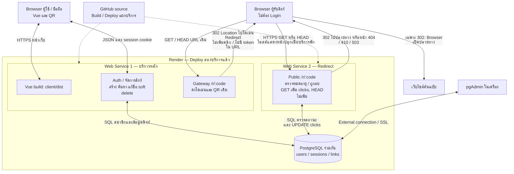

# Architecture Diagram — Short URL

## Microservices ที่ Deploy แล้ว

สถานะวันที่ 16 ตุลาคม 2026: main หลัง Merge โหมด browser handoff commit `7f09f71` Deploy ทั้งสองบริการแล้ว บริการหลัก https://short-url-4xil.onrender.com ตั้ง REDIRECT_SERVICE_MODE=browser และตอบ Location ไป https://short-url-redirect.onrender.com/r/:code ตามผล curl จากผู้ใช้ ผู้ใช้ยืนยันเปิดลิงก์ได้หลังพัก 15 นาที ดูรายละเอียดและขอบเขตหลักฐานใน [SUBMISSION.md](SUBMISSION.md#ผลออนไลน์ล่าสุดในโหมด-browser)

ทั้งสองบริการใช้ Node.js/Express JavaScript และ PostgreSQL เดิมร่วมกัน เป็นการแยกบริการที่ยังมี coupling ด้าน schema ไม่ใช่ database-per-service ไม่มี migration ใหม่

## ความรับผิดชอบ

| ส่วน | หน้าที่ |
|---|---|
| server | เสิร์ฟ Vue, สมาชิก/session, จัดการลิงก์ และ Gateway ของโดเมนเดิม |
| redirect-service | public /r ตรวจลิงก์และเพิ่ม clicks; /internal ตรวจ token สำหรับโหมด proxy; ไม่ให้บริการสมาชิก |
| PostgreSQL | schema เดิม ER ไม่เปลี่ยน บริการหลักแก้ข้อมูลลิงก์ ส่วน Redirect เพิ่มเฉพาะ clicks |
| Browser | เริ่มจาก URL เดิม แล้วเปิดโดเมน Redirect และเว็บไซต์ปลายทาง ไม่ได้รับ service token หรือ DATABASE_URL; QR สร้างบน Browser |
| GitHub | เก็บ source ไม่อยู่ในเส้นทางข้อมูลระหว่างเปิดลิงก์ |

## การสื่อสารและความล้มเหลว

- Gateway ใช้ origin จาก Environment ที่ผู้ดูแลกำหนด ไม่รับ URL บริการจากผู้ใช้
- โหมด browser ปัจจุบันส่ง 302 ไป public /r ของ Redirect โดยไม่เรียก health หรือส่งคำขอเพิ่มคลิกจาก Gateway การนับอยู่ที่ Redirect เท่านั้น
- โหมด proxy ยังคงเลือกใช้ได้ด้วย REDIRECT_SERVICE_MODE=proxy: ตรวจ health และส่ง service token ผ่าน HTTPS ไป /internal ตรวจ digest แบบ constant-time ไม่ตาม Location หรือ retry คำขอเปิดลิงก์ timeout รวมค่าเริ่มต้น 70 วินาที
- ในโหมด browser ถ้า Redirect พัก Browser จะผ่านหน้าปลุกของโฮสต์ ถ้าโฮสต์เสียอาจเห็นหน้าผิดพลาดจากโฮสต์; เมื่อคำขอถึง Express แล้วจึงใช้หน้าสถานะของแอป สมาชิกและการจัดการลิงก์แยกทำงานได้หากฐานข้อมูลพร้อม
- HEAD ที่โดเมนหลักตอบ 302 ไปบริการ Redirect เสมอสำหรับรหัสรูปแบบถูกต้อง ต้องตาม Location ไป HEAD อีกทอดจึงทราบสถานะจริง โดยทั้งสองทอดไม่เพิ่มคลิก
- ไม่มี REDIRECT_SERVICE_URL: server เลือก localRedirectRoutes เพื่อรองรับ rollback โหมดนี้ยังเป็น monolith ไม่ใช่การ Deploy สองบริการ
- ไม่ใช้ fallback SQL หลัง remote timeout เพราะอาจนับคลิกซ้ำ

## ข้อจำกัด

ภาพด้านบนแสดงโหมด browser ที่ใช้งานจริง ดูค่าตั้งและการย้อนกลับ proxy ใน [MICROSERVICES.md](MICROSERVICES.md#ทางเลือก-browser-handoff-สำหรับการปลุกบริการ) ลิงก์สั้นเดิมคงอยู่ แต่มีการเปลี่ยนโดเมนระหว่างเปิดเพิ่มหนึ่งทอด

ใช้ PostgreSQL ร่วมกัน จึงยังต้องประสาน schema, สิทธิ์ และการสำรองร่วมกัน ไม่มี distributed transaction, service discovery, queue หรือ exactly-once event analytics การเพิ่ม clicks เป็น atomic SQL ต่อคำขอที่ประมวลผลได้

Render Free ทั้งสอง Web Services รับคำขอผ่าน HTTPS สาธารณะ (Free ไม่รับ private network inbound) public /r ไม่ต้องใช้ token เช่นเดียวกับลิงก์สาธารณะเดิม ส่วน /internal ยังคงต้องใช้ token โควตาชั่วโมงรวมและ cold start ต้องตรวจใน Dashboard ดู [ข้อจำกัด Render](https://render.com/docs/free)

## วิธีอธิบาย

ผู้ใช้เปิด URL เดิม บริการหลักส่ง 302 ให้ Browser เปิดบริการ Redirect ที่ Deploy แยกกัน Redirect ตรวจสถานะ เพิ่มคลิกเฉพาะ GET ที่ใช้ได้ แล้วส่ง 302 ให้ Browser เปิดเว็บไซต์ปลายทาง ส่วนบริการหลักยังดูแลบัญชีและข้อมูลลิงก์เอง
