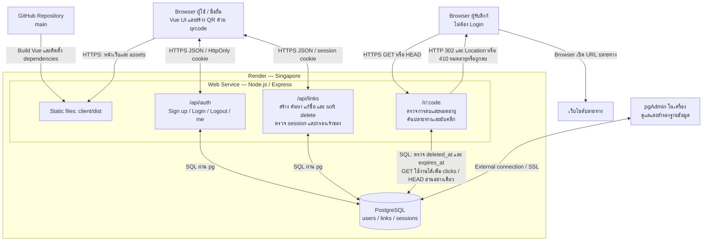

# Architecture Diagram — Short URL

## โครงสร้างระบบ

เป็นแอป Vue + Express แบบ Backend เดียว (monolith) ร่วมกับ PostgreSQL แยกบริการฐานข้อมูล ไม่อ้างว่าเป็น Microservice การแยก Router และฐานข้อมูลออกจากเว็บไม่เท่ากับแยก Backend เป็น Microservice

main หลัง Merge PR #5 มีชื่อ/ค้นหา/รหัสกำหนดเอง/หมดอายุ/soft delete ในบริการเดิม ไม่เพิ่มบริการใหม่ ผู้ใช้ยืนยัน migration 002 และ 003 สำเร็จ และ Logs ของ commit abb74ac ขึ้น Your service is live วันที่ 16 ตุลาคม 2026

URL ออนไลน์: https://short-url-4xil.onrender.com

GitHub แสดงแหล่ง source สำหรับ build ไม่ได้เป็นเส้นทางข้อมูลระหว่างผู้ใช้กับเว็บ การ Deploy ขึ้นกับการตั้งค่า Auto Deploy หรือสั่ง Manual Deploy ของ Render

## หน้าที่และขอบเขต

| ส่วน | หน้าที่จริง |
|---|---|
| Vue + CSS | ฟอร์มสมาชิกและลิงก์ ประวัติส่วนตัว คัดลอก QR และสถานะการทำงาน |
| Express static | ส่ง Vue build จาก client/dist ใช้โดเมนเดียวกับ API ไม่เปิด Vite บน Hosting |
| auth.js | scrypt, session, cookie, ตรวจ Origin/custom header และจำกัดความถี่ Login/Sign up |
| linkRoutes.js | สร้าง code สุ่มหรือกำหนดเอง แก้ชื่อ ลบแบบ soft delete ค้นหาและอ่านประวัติเฉพาะ user_id จาก session หน้าละ 10 รายการ |
| redirectRoutes.js | เปิดลิงก์สาธารณะ GET ที่ยังไม่ถูกลบและไม่หมดอายุเพิ่ม clicks และ 302; HEAD ไม่เพิ่ม clicks; หมดอายุหรือถูกลบตอบ 410 ด้วยหน้าสถานะที่แยกกัน |
| PostgreSQL | เก็บข้อมูลถาวร ไม่เก็บข้อมูลใน filesystem ชั่วคราวของ Web Service |
| pgAdmin | เครื่องมือผู้พัฒนา ไม่ใช่ฐานข้อมูลและไม่ต้องเปิดค้างเพื่อให้เว็บทำงาน |

## การเชื่อมต่อและตัวแปร

- Browser รู้เฉพาะ URL สาธารณะ ไม่ได้รับ DATABASE_URL หรือรหัสผ่านฐานข้อมูล
- Web Service ใช้ Internal Database URL ของ Render ใน Region เดียวกันผ่าน environment
- pgAdmin จากเครื่องใช้ External connection ตั้ง SSL ตามบริการ
- PUBLIC_BASE_URL เป็น https://short-url-4xil.onrender.com และ NODE_ENV เป็น production
- Hosting จัดสรร PORT ให้ ค่า localhost ที่พิมพ์ใน log เป็นที่อยู่ภายใน process ไม่ใช่ URL สำหรับส่งกรรมการ
- QR สร้างบน Browser จากลิงก์สั้น ไม่มี QR service ภายนอกหรือไฟล์ QR ในฐานข้อมูล

## ข้อแลกเปลี่ยน

- ใช้บริการเว็บเดียว ติดตั้งง่าย เหมาะกับเวลางาน แต่ขยาย/Deploy แต่ละฟังก์ชันแยกกันไม่ได้
- Rate limit เก็บใน memory ของ instance รีเซ็ตเมื่อ restart และยังไม่รองรับ store ร่วมหลาย instance
- เว็บฟรีอาจพัก ทำให้เปิดครั้งแรกช้า ฐานข้อมูลชุดนี้แสดงวันหมดอายุ 15 พฤศจิกายน 2026 ตาม Dashboard ที่ผู้ใช้ส่ง
- สถิติเป็นยอดเปิดรวม ไม่ใช่ unique visitors หรือยอดขาย ไม่อ้างว่ามี event analytics
- ถ้าจะแยก Microservice ภายหลัง ต้องแยก process/API/Deploy จริงและแก้ภาพตามระบบนั้น

## วิธีอธิบายตอนนำเสนอ

“ผู้ใช้เปิด Vue จาก Express ผ่าน HTTPS เมื่อ Login ระบบสร้าง session และเก็บ hash ของ token ใน PostgreSQL การสร้างและอ่านลิงก์ตรวจเจ้าของที่ Backend ส่วนผู้รับลิงก์เปิดเส้นทาง Redirect ได้โดยไม่ Login ระบบตรวจว่าลิงก์ยังไม่ถูกลบและไม่หมดอายุ ก่อนเพิ่มจำนวนเปิดแล้วส่ง HTTP 302 ให้ Browser ไปยังเว็บไซต์ต้นฉบับ หากหมดอายุหรือถูกลบจะตอบ 410 และไม่เพิ่มคลิก”
