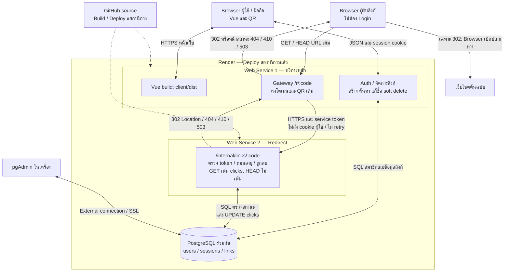

# Architecture Diagram — Short URL

## Microservices ที่ Deploy แล้ว

Merge PR #7 เข้า main และ Deploy commit 8644b34 วันที่ 16 ตุลาคม 2026 บริการหลัก https://short-url-4xil.onrender.com ขึ้น Redirect mode: remote service ส่วน https://short-url-redirect.onrender.com ขึ้น Redirect service ready ผู้ใช้ยืนยัน Redirect/QR/นับคลิก หมดอายุ และลบออนไลน์ตาม [SUBMISSION.md](SUBMISSION.md#ผลออนไลน์หลัง-deploy-pr-7) ข้อที่ยังไม่ตรวจซ้ำคงสถานะรอยืนยัน

ทั้งสองบริการใช้ Node.js/Express JavaScript และ PostgreSQL เดิมร่วมกัน เป็นการแยกบริการที่ยังมี coupling ด้าน schema ไม่ใช่ database-per-service ไม่มี migration ใหม่

## ความรับผิดชอบ

| ส่วน | หน้าที่ |
|---|---|
| server | เสิร์ฟ Vue, สมาชิก/session, จัดการลิงก์ และ Gateway ของโดเมนเดิม |
| redirect-service | ตรวจ service token, ค้น/ตรวจลิงก์ และเพิ่ม clicks ไม่ให้บริการสมาชิก |
| PostgreSQL | schema เดิม ER ไม่เปลี่ยน บริการหลักแก้ข้อมูลลิงก์ ส่วน Redirect เพิ่มเฉพาะ clicks |
| Browser | ใช้โดเมนเดิม ไม่ได้รับ service token หรือ DATABASE_URL; QR สร้างบน Browser |
| GitHub | เก็บ source ไม่อยู่ในเส้นทางข้อมูลระหว่างเปิดลิงก์ |

## การสื่อสารและความล้มเหลว

- Gateway ใช้ origin จาก Environment ที่ผู้ดูแลกำหนด ไม่รับ URL บริการจากผู้ใช้
- ใช้ service token ร่วมผ่าน HTTPS ฝั่ง Server และตรวจแบบ constant-time จาก digest ไม่ส่ง credentials นี้ไป Browser หรือ Location
- ไม่ตาม redirect ของ upstream และไม่ retry อัตโนมัติ timeout ค่าเริ่มต้น 70 วินาที
- Branch fix/redirect-cold-start ที่ยังไม่ Deploy เพิ่มการรอ `/healthz` แบบ read-only ภายใน timeout ก่อนส่งคำขอเปิดลิงก์หนึ่งครั้ง การตรวจ health ซ้ำไม่เพิ่ม clicks ส่วนคำขอเปิดลิงก์ยังไม่ retry
- เมื่อบริการ Redirect ล่มหรือ token ผิด เปิดลิงก์แสดงหน้า 503 ธีมเดียวกัน สมาชิกและการจัดการลิงก์ยังแยกทำงานได้หากฐานข้อมูลพร้อม
- ไม่มี REDIRECT_SERVICE_URL: server เลือก localRedirectRoutes เพื่อรองรับ rollback โหมดนี้ยังเป็น monolith ไม่ใช่การ Deploy สองบริการ
- ไม่ใช้ fallback SQL หลัง remote timeout เพราะอาจนับคลิกซ้ำ

## ข้อจำกัด

ทางเลือกใหม่ใน Branch fix/browser-redirect-handoff (ยังไม่เปิดออนไลน์): เมื่อ REDIRECT_SERVICE_MODE=browser Gateway ตอบ 302 ให้ Browser เปิด public `/r/:code` ของ Redirect service โดยตรง แทนการเรียกจาก Server เพื่อให้ Browser ผ่านหน้าปลุกบริการของโฮสต์ จากนั้น Redirect จึงตอบ 302 ไปปลายทางหรือหน้าสถานะ ใช้ DB เดิมและนับคลิกที่ Redirect เท่านั้น ไม่มี token ใน Browser ส่วนภาพด้านบนยังแสดงโหมด proxy ที่ Deploy อยู่ ดูลำดับเปิดใช้และความหมาย HEAD สองทอดใน [MICROSERVICES.md](MICROSERVICES.md#ทางเลือก-browser-handoff-สำหรับการปลุกบริการ)

ใช้ PostgreSQL ร่วมกัน จึงยังต้องประสาน schema, สิทธิ์ และการสำรองร่วมกัน ไม่มี distributed transaction, service discovery, queue หรือ exactly-once event analytics การเพิ่ม clicks เป็น atomic SQL ต่อคำขอที่ประมวลผลได้

Render Free ทั้งสอง Web Services รับคำขอผ่าน HTTPS สาธารณะ (Free ไม่รับ private network inbound) token จึงจำเป็น โควตาชั่วโมงรวมและ cold start ต้องตรวจใน Dashboard ดู [ข้อจำกัด Render](https://render.com/docs/free)

## วิธีอธิบาย

ผู้ใช้ยังเปิด URL เดิม บริการหลักส่งคำขอ GET/HEAD ให้บริการ Redirect ที่ Deploy แยกกัน โดยไม่ส่ง cookie ผู้ใช้ Redirect ตรวจสถานะและเพิ่มคลิกเฉพาะ GET ที่ใช้ได้ แล้วคืน Location ให้ Gateway ส่ง 302 สู่ Browser Browser จึงเปิดเว็บไซต์ปลายทาง ส่วนบริการหลักยังดูแลบัญชีและข้อมูลลิงก์เอง
