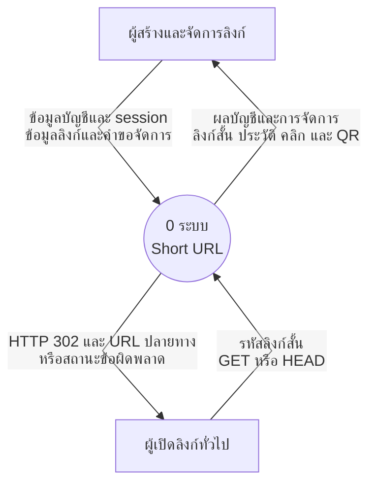
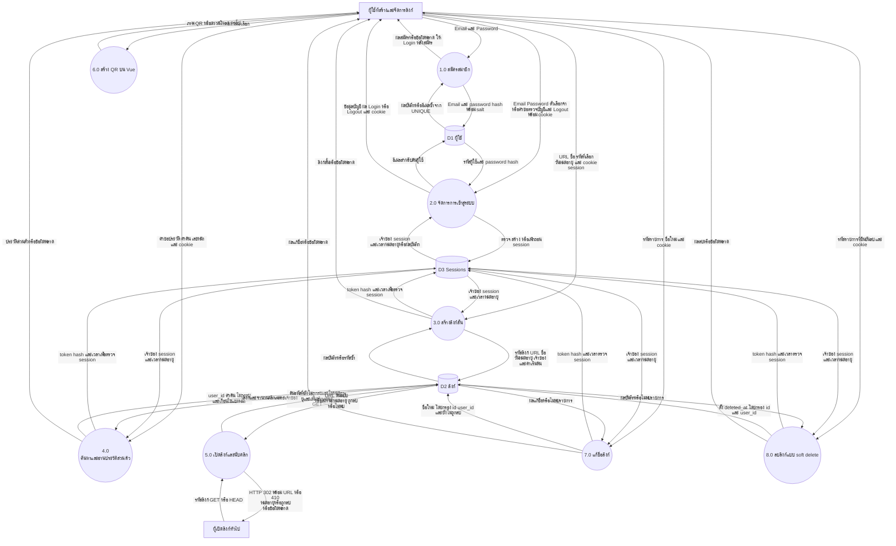
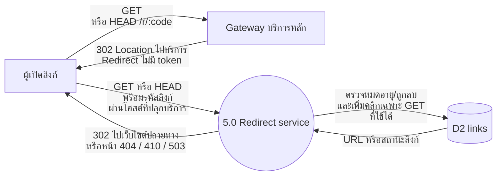

# Data Flow Diagram — Short URL พร้อม Login

แผนภาพครอบคลุมฟังก์ชันปัจจุบันของระบบ รวมสมาชิก การจัดการลิงก์ QR และ Redirect main หลัง PR #7 แยกการรันกระบวนการ 5.0 ไปยังบริการ Redirect ตามภาพท้ายเอกสาร Deploy สองบริการออนไลน์แล้ว วันที่ 16 ตุลาคม 2026 ดูหลักฐานและรายการที่ยังรอยืนยันใน [SUBMISSION.md](SUBMISSION.md#ผลออนไลน์หลัง-deploy-pr-7)
ภาพใช้ Mermaid เพื่อเปิดดูบน GitHub หรือ Markdown preview ที่รองรับ Mermaid

## Context Diagram (Process 0)

บางเกณฑ์เรียกภาพนี้ว่า DFD Level 0 จึงแยกจากภาพแตกกระบวนการด้านล่างไว้ชัดเจน

ภาพรวมจัดกลุ่มข้อมูลเพื่อลดเส้นที่ซ้อนกัน รายละเอียดทั้งหมดแสดงใน DFD กระบวนการ 1.0–8.0 ด้านล่าง:

- **ข้อมูลบัญชีและ session:** Email, Password, ตัวเลือกจำการเข้าสู่ระบบ, cookie session และคำขอตรวจบัญชีหรือ Logout
- **ข้อมูลลิงก์และคำขอจัดการ:** URL ต้นฉบับ ชื่อ รหัสที่เลือก วันหมดอายุ คำค้น เลขหน้า ลิงก์สำหรับสร้าง QR รหัสรายการสำหรับแก้ชื่อ และรายการที่ยืนยันลบ
- **ผลลัพธ์:** ผลสมัคร Login ตรวจบัญชี Logout พร้อมการตั้งหรือล้าง cookie; ผลสร้าง แก้ชื่อ หรือลบลิงก์; ประวัติส่วนตัว จำนวนคลิก ภาพ QR และไฟล์ PNG หรือข้อผิดพลาด
- **ผลเปิดลิงก์:** HTTP 302 พร้อม URL ปลายทาง หรือสถานะ 404 ไม่พบ, 410 หมดอายุหรือถูกลบ และ 503 เมื่อบริการไม่พร้อม

ผู้ใช้หนึ่งคนทำหน้าที่ทั้งสองบทบาทได้ ไม่ใช่ระบบแบ่งบทบาท Admin
HTTP 302 ส่งให้เบราว์เซอร์ผู้เปิดลิงก์ แล้วเบราว์เซอร์ไปเว็บไซต์ปลายทางเอง Server ไม่ดึงเนื้อหาเว็บปลายทางมาเก็บ

## DFD Level 0 — กระบวนการหลัก

แยกกระบวนการ 1.0–8.0 และแหล่งเก็บข้อมูลในขอบเขตเดียวกับ Context ด้านบน

## ขอบเขตการรันเมื่อแยกบริการ

ออนไลน์ปัจจุบันใช้โหมด browser: บริการหลักส่ง 302 ให้ Browser เปิด public /r/:code ของ Redirect service อีกทอด ไม่มี token ในเส้นทาง Browser และไม่เพิ่ม clicks ที่ Gateway การตรวจสถานะและเพิ่ม clicks ยังคงอยู่กระบวนการ 5.0 เหมือนเดิม ภาพต่อไปนี้แสดงเส้นทางที่ Deploy จริง ส่วนโหมด proxy ผ่าน /internal พร้อม token ยังคงเลือกกลับได้

กระบวนการ 1.0, 2.0, 3.0, 4.0, 7.0 และ 8.0 อยู่ในบริการหลัก กระบวนการ 6.0 อยู่ใน Browser ส่วน 5.0 ดำเนินการโดย redirect-service ผ่าน Gateway บริการหลัก ภาพ DFD ด้านบนเป็น logical data flow ทั้งระบบ ไม่ใช่ deployment diagram และ D2 ยังคงเป็นตาราง links ร่วมกัน

ออนไลน์เปิดโหมดสองบริการแล้ว หากนำ REDIRECT_SERVICE_URL ออกและรีสตาร์ต กระบวนการ 5.0 จะใช้โค้ด local rollback ในบริการหลักตามเดิม

## ขอบเขตและความสอดคล้อง

- D1, D2, D3 ตรงกับ users, links, sessions ใน [ER Diagram](ER.md)
- ขั้นสมัครในแบบนี้ไม่ Login อัตโนมัติ: สมัครสำเร็จแล้วเข้าสู่หน้า Login เพื่อลดความกำกวมของข้อมูล session
- คำขอสร้างและอ่านประวัติตรวจ session ที่ Backend ทุกครั้ง ไม่ใช่แค่ซ่อนหน้าบน Vue
- QR สร้างจากลิงก์บน Frontend ด้วยไลบรารีเดิม ไม่เพิ่มตาราง QR หรืออัปโหลดภาพเข้า Server
- DFD แสดงข้อมูลและกระบวนการ ไม่ใช่ลำดับคลิก หน้าจอ หรือแผนภาพ Microservice
- ประวัติกรองเจ้าของก่อนแบ่งหน้าละ 10 รายการ ลิงก์เก่า user_id NULL ยังเปิดได้แต่ไม่แสดงในบัญชีใหม่

## เกณฑ์ทดสอบหลังพัฒนา

1. สมัครอีเมลใหม่ได้ อีเมลซ้ำหลัง normalize ถูกปฏิเสธ และฐานข้อมูลไม่มีรหัสผ่านจริง
2. Login ถูกต้องได้ session ใหม่; รหัสผิดแสดงข้อความทั่วไปและมีการจำกัดความถี่
3. ผู้ใช้ A และ B เห็นเฉพาะประวัติของตน การส่ง user_id ของอีกคนเองไม่ทำให้เห็นข้อมูล
4. ผู้ไม่ Login สร้างลิงก์หรืออ่านประวัติส่วนตัวไม่ได้ แต่เปิดลิงก์สาธารณะได้
5. Logout แล้ว cookie/session เดิมใช้ต่อไม่ได้ และ session หมดอายุถูกปฏิเสธ
6. ลิงก์เดิมที่ไม่มีเจ้าของยังเปิดได้ ไม่ปรากฏในบัญชีใหม่; HEAD ไม่เพิ่มคลิก
7. สร้าง คัดลอก QR รีเฟรช และแบ่งหน้ายังทำงานครบทั้งคอมและมือถือ

8. ตั้งชื่อและแก้ชื่อได้เฉพาะเจ้าของ ไม่เปลี่ยน URL/QR ค้นหาชื่อ URL หรือรหัสข้ามทุกหน้าและไม่เห็นลิงก์ของบัญชีอื่น
9. รหัสกำหนดเองต้องถูกแบบและไม่ซ้ำ ไม่กรอกจะสุ่ม ตรวจวันหมดอายุเป็นเวลาในอนาคต
10. ลิงก์หมดอายุหรือถูกลบตอบ 410 ไม่ Redirect และไม่เพิ่มคลิกทั้ง GET/HEAD
11. ลบได้เฉพาะเจ้าของ หลังยืนยันซ่อนจากประวัติ/ค้นหา ไม่คืนรหัสให้ใช้ซ้ำ และลบรายการสุดท้ายแล้วย้อนหน้าได้
