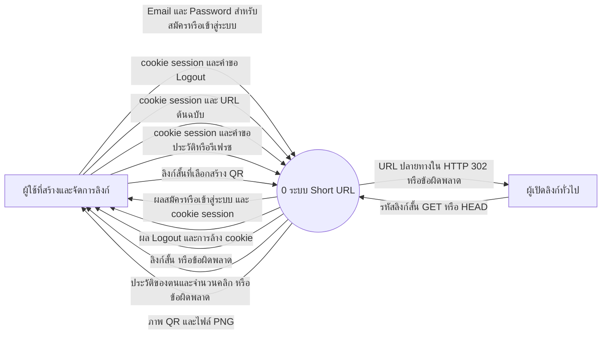
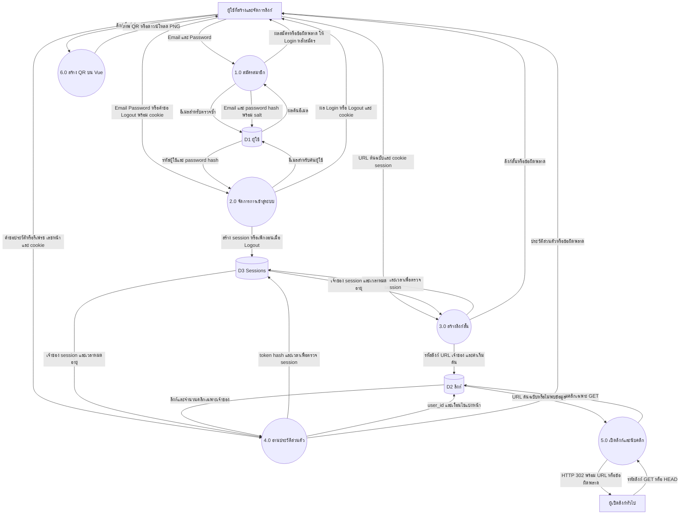

# Data Flow Diagram — Short URL พร้อม Login

สถานะ: แบบที่บันทึกก่อนพัฒนาและอัปเดตตาม Login/Sign up บน Branch `Feature/login` แล้ว ยังไม่ได้ Deploy รอบนี้
ภาพใช้ Mermaid เพื่อเปิดดูบน GitHub หรือ Markdown preview ที่รองรับ Mermaid

## Context Diagram (Process 0)

บางเกณฑ์เรียกภาพนี้ว่า DFD Level 0 จึงแยกจากภาพแตกกระบวนการด้านล่างไว้ชัดเจน

ผู้ใช้หนึ่งคนทำหน้าที่ทั้งสองบทบาทได้ ไม่ใช่ระบบแบ่งบทบาท Admin
HTTP 302 ส่งให้เบราว์เซอร์ผู้เปิดลิงก์ แล้วเบราว์เซอร์ไปเว็บไซต์ปลายทางเอง Server ไม่ดึงเนื้อหาเว็บปลายทางมาเก็บ

## DFD แตกกระบวนการหลัก

ภาพนี้เรียก Level 1 เมื่อ Context เป็น Level 0; หากผู้ประเมินเรียกภาพแตกกระบวนการว่า Level 0 ให้ใช้ชื่อระดับตามเกณฑ์ โดยคงความหมายของภาพ

## ขอบเขตและความสอดคล้อง

- D1, D2, D3 ตรงกับ users, links, sessions ใน [ER Diagram](ER.md)
- ขั้นสมัครในแบบนี้ไม่ Login อัตโนมัติ: สมัครสำเร็จแล้วเข้าสู่หน้า Login เพื่อลดความกำกวมของข้อมูล session
- คำขอสร้างและอ่านประวัติตรวจ session ที่ Backend ทุกครั้ง ไม่ใช่แค่ซ่อนหน้าบน Vue
- QR สร้างจากลิงก์บน Frontend ด้วยไลบรารีเดิม ไม่เพิ่มตาราง QR หรืออัปโหลดภาพเข้า Server
- DFD แสดงข้อมูลและกระบวนการ ไม่ใช่ลำดับคลิก หน้าจอ หรือแผนภาพ Microservice
- ระบบเดิมอ่านประวัติรวม; Branch นี้เพิ่มสมาชิก session และกรองเจ้าของแล้ว ส่วน Render ยังไม่ได้อัปเดตในรอบนี้

## เกณฑ์ทดสอบหลังพัฒนา

1. สมัครอีเมลใหม่ได้ อีเมลซ้ำหลัง normalize ถูกปฏิเสธ และฐานข้อมูลไม่มีรหัสผ่านจริง
2. Login ถูกต้องได้ session ใหม่; รหัสผิดแสดงข้อความทั่วไปและมีการจำกัดความถี่
3. ผู้ใช้ A และ B เห็นเฉพาะประวัติของตน การส่ง user_id ของอีกคนเองไม่ทำให้เห็นข้อมูล
4. ผู้ไม่ Login สร้างลิงก์หรืออ่านประวัติส่วนตัวไม่ได้ แต่เปิดลิงก์สาธารณะได้
5. Logout แล้ว cookie/session เดิมใช้ต่อไม่ได้ และ session หมดอายุถูกปฏิเสธ
6. ลิงก์เดิมที่ไม่มีเจ้าของยังเปิดได้ ไม่ปรากฏในบัญชีใหม่; HEAD ไม่เพิ่มคลิก
7. สร้าง คัดลอก QR รีเฟรช และแบ่งหน้ายังทำงานครบทั้งคอมและมือถือ
