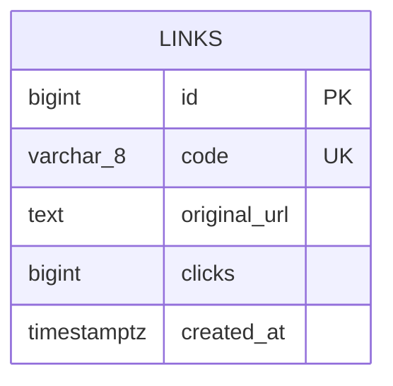
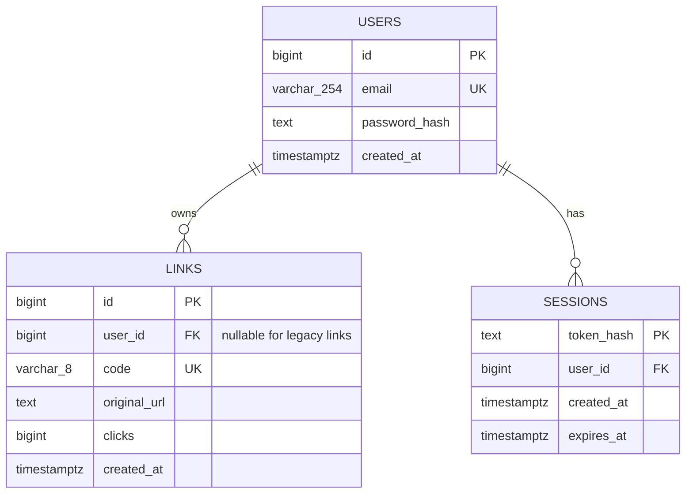

# ER Diagram — Short URL

สถานะ: แบบก่อนพัฒนาระบบ Login/Sign up ไม่ใช่โครงสร้างที่ติดตั้งแล้ว
โค้ดปัจจุบันมีเฉพาะ `links` และยังแสดงประวัติรวม แบบนี้ใช้เป็นขอบเขตสำหรับพัฒนาถัดไป

## ฐานข้อมูลปัจจุบัน

`id` เป็น identity, `code` ไม่ซ้ำ, clicks เริ่ม 0 และต้องไม่ติดลบ, created_at เริ่มจากเวลาปัจจุบัน ทุกคอลัมน์ห้าม NULL

## แบบเพิ่มการยืนยันตัวตน

ความสัมพันธ์: ผู้ใช้หนึ่งคนมีลิงก์ได้ศูนย์ถึงหลายรายการ และมี session ได้หลายอุปกรณ์
ลิงก์ใหม่ต้องมีเจ้าของหนึ่งคน ส่วนลิงก์เก่าอนุญาตไม่มีเจ้าของ จึงมีข้อยกเว้นจากเส้นความสัมพันธ์ LINKS ในภาพ: `user_id` เป็น NULL ได้เฉพาะข้อมูลเดิม

## พจนานุกรมข้อมูลที่เสนอ

| ตาราง/คอลัมน์ | ข้อกำหนดและการใช้งาน |
|---|---|
| users.id | bigint identity, primary key |
| users.email | varchar(254), not null, unique; normalize โดย trim และแปลง lowercase ก่อนเก็บ/ค้นหา |
| users.password_hash | text, not null; เก็บผลจาก password hashing ที่มี salt ไม่เก็บรหัสผ่านจริง |
| users.created_at | timestamptz, not null, default now() |
| links.user_id | bigint, nullable สำหรับลิงก์เดิม; FK ไป users.id; เพิ่ม index สำหรับค้นประวัติตามเจ้าของ |
| links คอลัมน์เดิม | รักษาชนิดข้อมูล default และ constraints ของระบบปัจจุบัน |
| sessions.token_hash | text, primary key; เก็บ hash ของ session token สุ่ม ไม่เก็บ token ดิบ |
| sessions.user_id | bigint, not null, FK ไป users.id; เพิ่ม index |
| sessions.created_at | timestamptz, not null, default now() |
| sessions.expires_at | timestamptz, not null; ต้องมากกว่า created_at; เพิ่ม index เพื่อทำความสะอาด session หมดอายุ |

## กติกาในการพัฒนา

- สมัครสมาชิกใช้ Email และ Password; ไม่มีระบบ Admin, social login, ยืนยันอีเมล หรือรีเซ็ตรหัสผ่านในรอบแรก
- ใช้ password hashing สำหรับรหัสผ่าน เช่น scrypt ผ่าน Node.js crypto พร้อม salt สุ่มและค่าพารามิเตอร์ที่บันทึกไว้สำหรับตรวจสอบภายหลัง ไม่ใช้ SHA-256 เปล่า ๆ กับรหัสผ่าน
- สร้าง session token แบบสุ่ม ส่งเฉพาะ cookie HttpOnly, SameSite=Lax และ Secure บน HTTPS; ฝั่งฐานข้อมูลเก็บ token hash เท่านั้น
- ค่าเริ่มต้นที่เสนอ: session อายุ 7 วัน ไม่ต่ออายุเงียบ; Logout ลบ session ฝั่ง Server และล้าง cookie ต้องตรวจเวลาหมดอายุทุกคำขอและมีงานล้างแถวหมดอายุ
- เปลี่ยน session เมื่อ Login สำเร็จ; ไม่ส่ง password_hash หรือ token_hash กลับใน API
- ตรวจ Origin และป้องกัน CSRF สำหรับคำขอที่เปลี่ยนข้อมูล พร้อมจำกัดความถี่ Login/Sign up
- API สร้างลิงก์ต้อง Login และกำหนด user_id จาก session ห้ามเชื่อค่าเจ้าของที่ผู้ใช้ส่งมา
- ประวัติ query เฉพาะ user_id จาก session และแบ่งหน้าหลังกรองเจ้าของแล้ว
- คนทั่วไปเปิด `/r/:code` ได้โดยไม่ Login; GET เพิ่มคลิก ส่วน HEAD ไม่เพิ่มคลิก
- ลิงก์เดิมคง user_id=NULL ไม่แจกให้บัญชีแรกหรือบัญชีใดอัตโนมัติ เปิด Redirect ได้ แต่ไม่แสดงในประวัติส่วนตัว
- ไม่มีลบบัญชีในรอบนี้; FK ใช้ NO ACTION สำหรับลิงก์เพื่อไม่ให้ลิงก์สาธารณะถูกลบตามบัญชีโดยไม่ตั้งใจ ส่วน session เสนอ ON DELETE CASCADE

## แผนเปลี่ยนฐานข้อมูล

1. สำรองฐานข้อมูลในเครื่องและทดสอบบนสำเนาก่อน
2. เพิ่ม users และ sessions แล้วเพิ่ม links.user_id แบบ nullable พร้อม FK/index โดยไม่ลบข้อมูลเดิม
3. ทดสอบหลายบัญชี การเข้าถึงข้ามบัญชี session หมดอายุ และลิงก์เดิม
4. เขียน migration และขั้นตอน rollback ที่ไม่ทำข้อมูลสูญหายก่อนใช้กับ Render
5. อัปเดตภาพและรายละเอียดนี้เป็นแบบที่พัฒนาแล้วหลังตรวจ schema จริง

เอกสารนี้ไม่ใช่ SQL migration และยังไม่อนุญาตให้เปลี่ยนฐานข้อมูลออนไลน์โดยอัตโนมัติ
