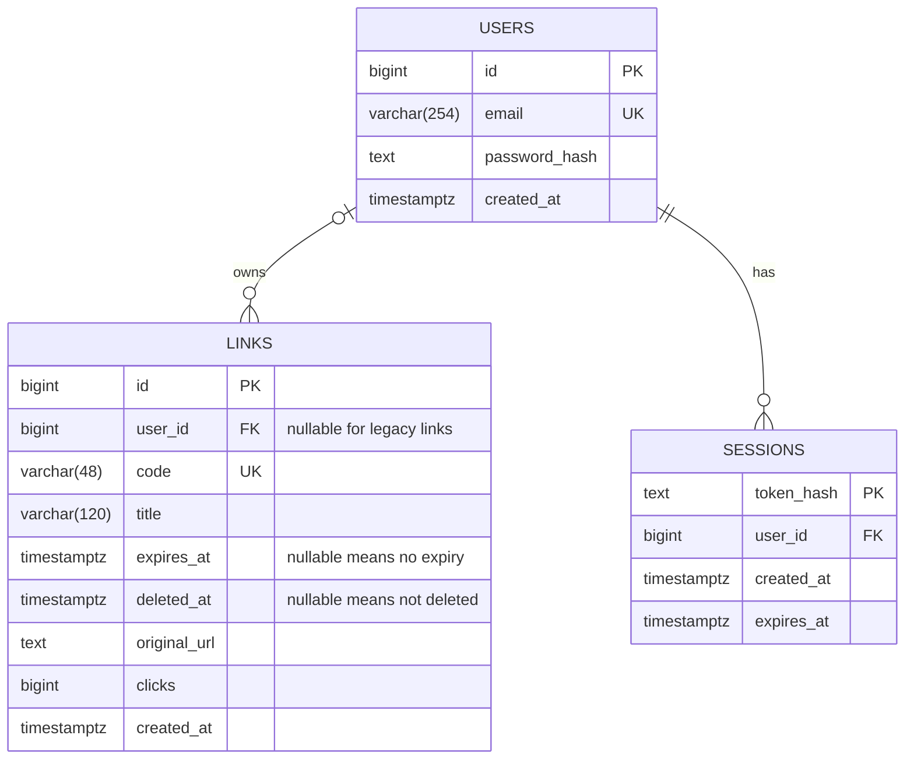

# ER Diagram — Short URL

โครงสร้างของ main หลัง Merge PR #5 และ migration 001 → 002 → 003 บน Render ผู้ใช้ยืนยัน Query สำเร็จและคอลัมน์จริงแล้ว วันที่ 16 ตุลาคม 2026 Deploy commit abb74ac สำเร็จ และแสดง deleted_at ของลิงก์ที่ลบออนไลน์แล้ว

## การใช้ข้อมูลในโหมดสองบริการ

Branch feature/microservices ไม่เพิ่มตารางหรือคอลัมน์ บริการหลักดูแล users/sessions และข้อมูล links ส่วน redirect-service อ่าน code/original_url/expires_at/deleted_at และ UPDATE clicks ในตาราง links เดิม ขอบเขตการใช้ฐานข้อมูลร่วมกันอธิบายใน [Architecture](ARCHITECTURE.md) ไม่อ้างว่าแยกฐานข้อมูลอิสระ

## ความสัมพันธ์ฐานข้อมูล

- ผู้ใช้มีลิงก์ได้ 0 ถึงหลายรายการ ลิงก์มีเจ้าของได้ 0 หรือ 1 คน เพราะข้อมูลเก่าก่อนเพิ่ม Login มี `user_id=NULL`
- API กำหนดเจ้าของให้ลิงก์ใหม่จาก session เสมอ แม้ schema อนุญาต NULL เพื่อรักษาลิงก์เดิม
- ผู้ใช้มี session ได้หลายรายการ แต่ละ session ต้องมีเจ้าของหนึ่งคน
- ไม่สร้างตาราง QR เพราะสร้างภาพบน Frontend ไม่เก็บตารางคลิกแยก เพราะเก็บยอดรวมที่ `links.clicks`

## พจนานุกรมข้อมูล

| ตาราง.คอลัมน์ | ชนิด | ข้อกำหนด / ความหมาย |
|---|---|---|
| users.id | bigint | Identity, PK, NOT NULL |
| users.email | varchar(254) | UNIQUE, NOT NULL, CHECK ให้เป็น lowercase และไม่มีช่องว่างหัวท้าย |
| users.password_hash | text | NOT NULL; scrypt พร้อม salt และพารามิเตอร์ ไม่เก็บรหัสผ่านจริง |
| users.created_at | timestamptz | NOT NULL, DEFAULT now() |
| links.id | bigint | Identity, PK, NOT NULL |
| links.user_id | bigint | Nullable, FK → users.id; ON DELETE NO ACTION |
| links.code | varchar(48) | UNIQUE, NOT NULL; สุ่ม 8 ตัวหรือผู้ใช้เลือก 3–48 ตัว API ตรวจรูปแบบ |
| links.title | varchar(120) | NOT NULL, DEFAULT ว่าง; ชื่อแสดงผล แก้ได้โดยเจ้าของ |
| links.deleted_at | timestamptz | Nullable; NULL ยังไม่ลบ มีค่าเมื่อเจ้าของยืนยันลบ เก็บแถวและ code ไว้ |
| links.expires_at | timestamptz | Nullable; NULL ไม่หมดอายุ API รับเฉพาะอนาคตตอนสร้าง |
| links.original_url | text | NOT NULL; API รับ HTTP(S) ไม่เกิน 4096 ตัวอักษร และไม่รับ URL ที่มี username/password |
| links.clicks | bigint | NOT NULL, DEFAULT 0, CHECK >= 0; รวมการเปิดซ้ำ |
| links.created_at | timestamptz | NOT NULL, DEFAULT now() |
| sessions.token_hash | text | PK, NOT NULL; SHA-256 ของ session token สุ่ม ไม่ใช่ token ดิบ |
| sessions.user_id | bigint | NOT NULL, FK → users.id; ON DELETE CASCADE |
| sessions.created_at | timestamptz | NOT NULL, DEFAULT now() |
| sessions.expires_at | timestamptz | NOT NULL, CHECK > created_at |

ข้อจำกัดความยาวรหัสผ่าน, URL และนโยบาย session ตรวจในแอป ไม่ใช่ CHECK ทั้งหมดในฐานข้อมูล

## Index เพิ่มเติมจาก migration

- `links_user_created_idx (user_id, created_at DESC, id DESC)` สำหรับประวัติเฉพาะเจ้าของ เรียงใหม่ก่อน และแบ่งหน้าละ 10 รายการ
- `sessions_user_idx (user_id)` สำหรับค้น session ตามเจ้าของ
- `sessions_expiry_idx (expires_at)` สำหรับล้าง session หมดอายุ
- Primary key และ UNIQUE สร้าง index รองรับโดย PostgreSQL

## กติกาปัจจุบัน

- Sign up ตรวจ Password 6–12 ตัวอักษรและมี A–Z อย่างน้อยหนึ่งตัว ตามขอบเขตเดโมที่เลือก ไม่มีการบังคับนโยบายใหม่นี้กับรหัสเดิมตอน Login (รับ 1–128 ตัวอักษรเพื่อรองรับบัญชีเดิม)
- scrypt ใช้ N=32768, r=8, p=3, salt สุ่ม 16 bytes และ derived key 64 bytes
- Session token สุ่ม 32 bytes ส่ง cookie HttpOnly, SameSite=Lax และ Secure พร้อมชื่อ __Host-short_session บน production
- ไม่เลือกจำ: session สูงสุด 12 ชั่วโมงและไม่มี Max-Age; เลือกจำ: cookie และ session อายุ 7 วัน ไม่ต่ออายุเงียบ Logout ลบ session และล้าง cookie
- ตรวจ expires_at ทุกคำขอที่ต้อง Login และล้าง session หมดอายุเมื่อ Login สำเร็จ
- เก็บ Email ที่เลือกจำใน localStorage ได้ แต่ Password ให้ Password Manager ของเบราว์เซอร์จัดการ ไม่เก็บ session token หรือรหัสผ่านใน localStorage
- ลิงก์เก่าไม่มีเจ้าของยัง Redirect ได้ แต่ไม่แสดงในประวัติของบัญชีใหม่ ไม่โอนให้บัญชีแรกอัตโนมัติ
- รหัสไม่เปลี่ยนภายหลังและไม่ใช้รหัสหมดอายุซ้ำ เพื่อรักษาความหมายของ URL/QR ที่แชร์แล้ว
- หมดอายุเมื่อ expires_at <= เวลา Server; GET/HEAD ตอบ 410 ไม่เพิ่มคลิก
- DELETE /api/links/:id ตั้ง deleted_at เฉพาะเจ้าของ ไม่ลบแถวจริง ไม่แสดงในประวัติ/ค้นหา และแก้ชื่อไม่ได้หลังลบ
- ลิงก์ที่ลบแล้วตอบ 410 พร้อมหน้าถูกลบ ไม่เพิ่มคลิก ไม่ Redirect ไม่คืนรหัสให้ใช้ซ้ำ ไม่มี API กู้คืน
- ไม่มี API ลบบัญชีหรือย้ายเจ้าของ จึงไม่ลบลิงก์ตามบัญชีโดยอัตโนมัติ

## แหล่งอ้างอิงใน Repository

- ตาราง links ตั้งต้น: [README](../README.md#สร้างฐานข้อมูล)
- การลบลิงก์: [003_soft_delete.sql](../server/migrations/003_soft_delete.sql)
- การจัดการลิงก์: [002_link_management.sql](../server/migrations/002_link_management.sql)
- ตารางสมาชิกและ index: [001_auth.sql](../server/migrations/001_auth.sql)
- การจัดการ session/password: [auth.js](../server/auth.js)
- เจ้าของลิงก์และประวัติ: [linkRoutes.js](../server/linkRoutes.js)

การเปลี่ยน schema ในอนาคตต้องมี migration และสำรองก่อน ไม่ใช้ไฟล์นี้แทน SQL และไม่ต้องรัน migration เดิมซ้ำเพียงเพราะปรับเอกสาร
